# FANUC 铣削编程助手（W版）· 模块详细说明

> 版本 v1.6.0 ｜ 形态：单文件 HTML（`index.html`），零依赖、无需联网即可用（AI 生成模块除外）
> 适用：FANUC 0i 系统立式加工中心铣削编程教学
> 配套教材：《数控铣削编程与加工（FANUC系统）》朱勤惠、沈建峰主编，机械工业出版社

---

## 0. 快速开始

### 打开方式

直接双击 `index.html` 用浏览器打开即可，不需要安装任何东西。若通过局域网共享给机房使用，可放在任意静态服务器上，或用本地临时服务：

```bash
python -m http.server 8765
# 浏览器访问 http://127.0.0.1:8765/index.html
```

### 我要做什么 → 用哪个模块

| 我要… | 去哪个面板 | 一句话说明 |
|---|---|---|
| 查某条 G/M 代码干什么用的 | G/M 代码速查 | 51 条指令，可搜索、可按类筛选 |
| 快速起一个规范的程序框架 | 程序编辑器 | 6 个模板，点一下填进编辑器 |
| 算转速、进给、功率 | 参数计算 | 材料联动，超转速自动折算 |
| 搞懂学生程序每一行 | 程序解释 | 逐行翻译，连 D 号、R 值都解释 |
| 检查程序有没有结构性错误 | 程序校验 | 43 条规则，每条带"为什么错、怎么改" |
| 让学生看见刀怎么走的 | 刀轨演示 | 2D 轨迹 + 分步播放 + 刀补偏置 |
| 核对程序尺寸对不对 | 刀轨演示 → 尺寸核对 | 按图纸尺寸逐项比对 |
| 批一堆作业 | 批量批改 | 打分 + 问题清单 + 刀轨对比 + 导出 CSV |
| 让学生练找错 | 找错练习 | 自动注入典型错误，交卷对答案 |
| 上传图纸自动出程序 | AI 智能编程 → 图纸生成程序 | SVG 精确解析 / 位图视觉识别 → 生成 + 校验 + 刀轨 |
| 生成一段示例程序 | AI 智能编程 → 文字描述生成程序 | 自然语言描述需求，云端模型生成 |
| 想查这份说明的完整版 | 帮助 | 应用内的详细说明，带截图，断网也能查 |

---

## 1. 通用功能

这几个功能不属于某个单一模块，全站通用。

### 1.1 大屏演示模式

**位置**：右上角「大屏」按钮。

**效果**：整站字号放大一级、画布由 440px 提升到 620px、内容区宽度放宽到 1640px，适合投影仪或教室一体机。

**退出**：再点一次「大屏」，或按 `Esc`。

**课堂用法**：讲刀轨时先开大屏，把「刀轨演示」面板投出来，学生能看清刀心轨迹和当前执行段。

### 1.2 本地自动保存

**保存范围**：编辑器内容、解释框内容、参数计算的全部输入、校验框与宏试算、刀轨程序与刀径、批量批改的两栏与扣分权重、找错练习的病灶程序。

**机制**：输入停止 500ms 后写入浏览器 localStorage，右上角出现「已自动保存」提示。刷新、关闭浏览器再打开，内容都还在。

**注意**：
- 数据只存在**当前这台电脑、这个浏览器**里，换机器或清浏览器缓存就没了，重要内容请用「复制程序」或「导出讲义」留档。
- 「清本地保存」按钮（在程序编辑器面板的编辑器上方）可一次性清除全部本地数据。

### 1.3 导出讲义

**位置**：刀轨演示面板 →「导出讲义」。

**产出**：一个可独立打开的 HTML 文件，内含
1. 程序原文（等宽字体、深色底）
2. 刀轨截图（当前画布状态）
3. 路径统计（切削长度、快移长度、包围盒、预估工时、圆弧数、孔位数）
4. 校验结果（只列错误与警告）
5. 逐行解释

**用法**：生成后在浏览器里 `Ctrl+P` 直接打印成纸质讲义，或发给学生当课后复习材料。样式里已写 `@media print`，打印会自动去掉多余空白。

### 1.4 帮助面板

「帮助」面板是这份说明的**应用内版本**，内容与 `docs/使用说明.md` 同源。

- 左侧目录可点击跳转，也可在搜索框输入关键词过滤（如「刀补」「批改」）
- 右侧正文支持表格、代码块、讲解与截图
- 断网也能查，因为内容和图片都已嵌在 `index.html` 里

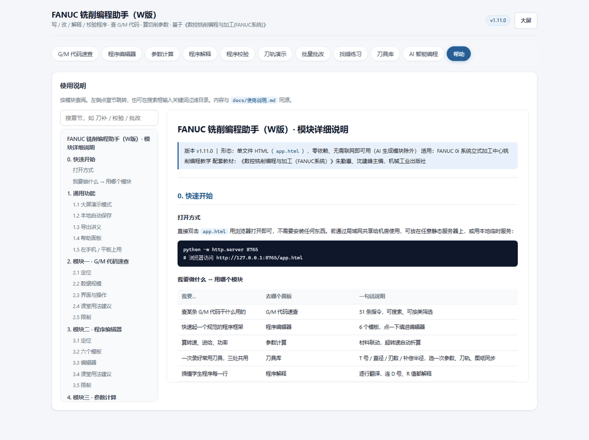

**维护方式**：改完 `docs/使用说明.md`，或替换 `docs/img/` 里的截图之后，运行

```
node tools/sync-doc.js --embed
```

即可把最新文字与图片写回 `index.html`。反方向用 `--extract`。图片以 base64 内嵌，所以 `index.html` 始终是"一个文件拷走就能用"。

---

## 2. 模块一 · G/M 代码速查

### 2.1 定位

把教材附录里的指令表搬到屏幕上，解决"讲课时想不起某条指令的格式"和"学生课后抄错指令"两个问题。

### 2.2 数据规模

| 类别 | 条数 | 说明 |
|---|---|---|
| G 代码 | 39 条 | G00~G99，含 G50.1 / G51.1 镜像 |
| M 代码 | 12 条 | M00~M30、M98、M99 |
| 合计 | **51 条** | |

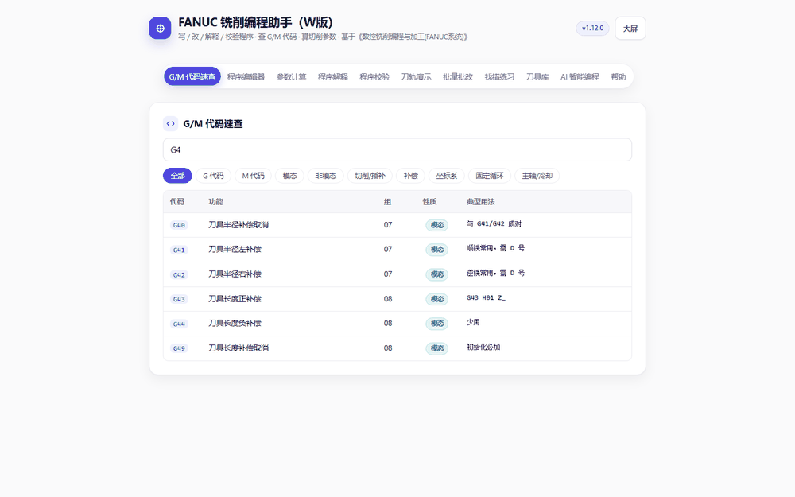

每条记录五个字段：**代码、功能（中文）、所在组号、模态性质、典型用法**。

### 2.3 界面与操作

**搜索框**：一个字一个字匹配，同时搜三处——代码本身（不区分大小写）、中文功能名、典型用法示例。
- 输 `g41` → 精准命中
- 输 `钻孔` → 列出 G73/G81/G82/G83/G84 等
- 输 `补偿` → 列出 G40/G41/G42/G43/G44/G49

**筛选标签**（10 个）：

| 标签 | 作用 |
|---|---|
| 全部 | 51 条全列 |
| G 代码 / M 代码 | 按首字母分 |
| 模态 / 非模态 | 模态指"写一次后续程序段继续有效"，这是学生最常混淆的概念 |
| 切削·插补 | G00~G04 |
| 补偿 | G40~G49 |
| 坐标系 | G17~G28、G50.1~G59、G68/G69 |
| 固定循环 | G73~G89 |
| 主轴·冷却 | M00~M09、M30、M98、M99 |

**表格**：表头固定，纵向滚动时列名不消失。

### 2.4 课堂用法建议

1. **讲模态概念**：先点「模态」，让学生看 G00 写一次后还管着后面所有段；再点「非模态」，对比 G04、G28、G52 只在当前段有效。
2. **讲组号**：同一组号的指令不能同时出现在一段里——这正好是校验规则 E07 的理论依据，讲完立刻去「程序校验」演示 `G90 G91` 同段会报错。
3. **让学生自查格式**：写 G84 前先搜一下，确认 `X Y Z R F` 哪些是必需的。

### 2.5 限制

- 只覆盖教材范围内的常用指令。G73 以外的复合循环（G70/G71 车削类）、G10 可编程数据输入、G31 跳转等未收录。
- "未收录"不等于"错误"，校验器遇到未收录指令只给提示（I01），不报错。

---

## 3. 模块二 · 程序编辑器

### 3.1 定位

给学生一个"能跑通的起点"。空白页面最劝退，有一副骨架后学生只需要往中间填加工内容。

### 3.2 六个模板

| 模板 | 说明 | 关键指令 |
|---|---|---|
| 通用程序骨架 | 标准初始化 + 单刀结构 | G21 G90 G17 G40 G49 G80 → G54 → M06 T01 → G43 H01 Z50 M03 S3000 |
| 带刀补轮廓程序 | 完整的外轮廓走刀，含刀补建立与取消 | G41 D01 建立、G40 取消 |
| 子程序结构 | 主程序调用 + 子程序定义写在同一文件 | M98 P2000 / M99 |
| 孔加工固定循环 | 一排孔的钻孔 | G81 X_ Y_ Z_ R_ F_ → G80 |
| 坐标旋转 | 旋转后加工同一形状 | G68 X_ Y_ R_ / G69 |
| 镜像加工 | 左右对称件 | G51.1 X0 / G50.1 |

**操作**：点卡片 → 自动跳到下方编辑器并填入代码 → 按需修改。

### 3.3 编辑器

页面上有一块多行文本框，是"当前正在处理的程序"。它也承载了自动保存。

**四个辅助按钮**：

| 按钮 | 动作 |
|---|---|
| 插入程序头 | 在光标所在文本最前面插入 `G21 G90 G17 G40 G49 G80;` `G54 G00 X0 Y0;` `M06 T01;` `G43 H01 Z50 M03 S3000;` |
| 插入程序尾 | 在末尾追加 `G00 Z50;` `M05;` `M09;` `G91 G28 Z0;` `M30;` |
| 清空 | 清掉编辑器内容（不影响本地保存的其他区域） |
| 清本地保存 | 清除全部本地存储（含编辑器、校验、刀轨、批改等） |

**两个动作按钮**：

| 按钮 | 动作 |
|---|---|
| 解释这段程序 | 把编辑器内容送到「程序解释」面板并自动执行 |
| 复制程序 | 复制到系统剪贴板，方便贴进仿真软件或发给学生 |

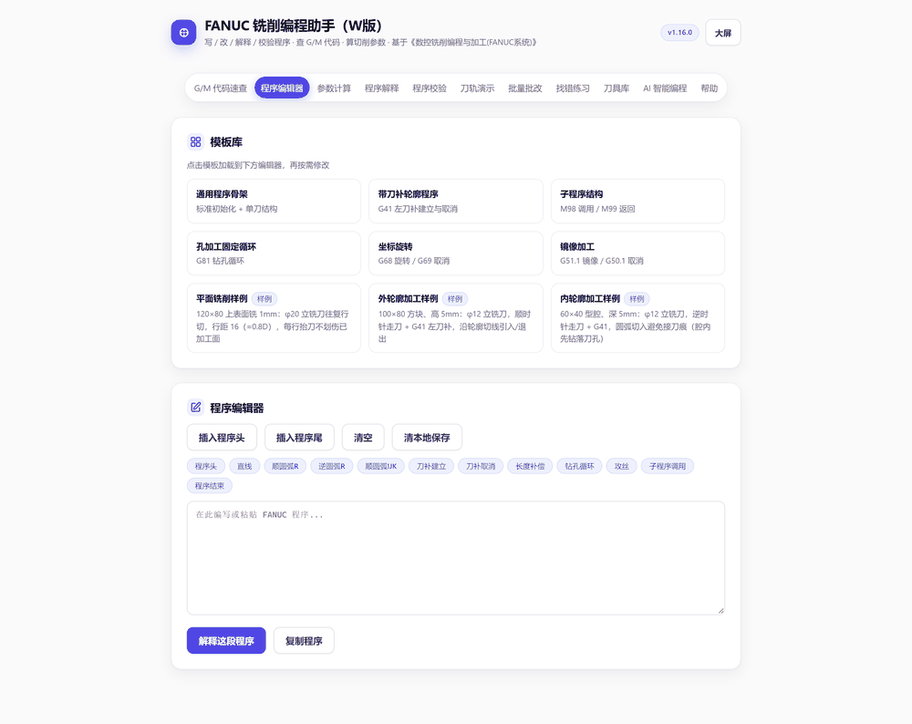

### 3.4 课堂用法建议

- **第一节课**：让学生打开「通用程序骨架」，逐行问"这句不写会怎样"——正好用「程序校验」逐条删掉验证。
- **分层练习**：基础弱的学生从骨架改尺寸；基础好的学生从空白页写，写完用骨架对照。
- 模板里的 `... 加工内容 ...` 是占位，校验器不会把它当错误（没有地址字），学生可以放心保留到自己写完。

### 3.5 限制

- 模板是**编程风格示例**，不是特定零件的加工程序，切削参数（S3000、F100 等）只作格式示范，实际必须按材料与刀具重算。
- 「坐标旋转」「镜像加工」两个模板是**指令片段**（没有 O 号与 M30），送去校验时会被判定为"程序片段"模式（I06），只查指令用法。

---

## 4. 模块三 · 参数计算

### 4.1 定位

把"转速进给怎么定"从背公式变成点几下就有结果，并且顺带让学生理解：**转速是被切削速度决定的，进给是被转速决定的**。

### 4.2 输入

| 输入项 | 说明 |
|---|---|
| 工件材料 | 铝合金 / 45 钢 / 合金钢 / 不锈钢 / 铸铁 / 铜合金 |
| 刀具材料 | 硬质合金 / 高速钢 |
| 切削速度 Vc (m/min) | 切换上面两项时**自动填入该材料该刀具的推荐中值**，可手动改 |
| 刀具直径 D (mm) | 铣刀直径 |
| 齿数 z | 立铣刀常见 3~4 刃 |
| 每齿进给 fz (mm/z) | 见下方参考值 |
| 背吃刀量 ap (mm) | 轴向切深 |
| 切削宽度 ae (mm) | 径向切宽，用来算材料去除率与功率 |
| 机床主轴上限 (r/min) | 超过时自动折算，默认 8000 |

**材料推荐值表**（页面下方常驻显示）：

| 材料 | 硬质合金 Vc (m/min) | 高速钢 Vc (m/min) | 单位切削力 kc (N/mm²) |
|---|---|---|---|
| 铝合金 | 150 ~ 300 | 60 ~ 120 | 700 |
| 45 钢 / 碳钢 | 80 ~ 150 | 20 ~ 35 | 2000 |
| 合金钢 | 60 ~ 120 | 15 ~ 30 | 2300 |
| 不锈钢 | 40 ~ 80 | 10 ~ 20 | 2500 |
| 铸铁 | 60 ~ 120 | 15 ~ 25 | 1200 |
| 铜合金 | 100 ~ 200 | 40 ~ 80 | 900 |

切换材料时，表格中对应行会高亮，方便学生对照。

### 4.3 输出

| 输出 | 公式 | 含义 |
|---|---|---|
| 主轴转速 n | `n = 1000 × Vc / (π × D)` | 结果取整 |
| 进给速度 F | `F = n × fz × z` | 结果取整；若转速超上限，按上限重算 |
| 材料去除率 Q | `Q = ae × ap × F` | 显示为 cm³/min |
| 切削功率 Pc | `Pc = Q × kc / 6×10⁷` | kW |
| 建议主轴功率 | `Pm = Pc / 0.8` | 按机床效率 0.8 反推，选机床时看这个 |

下方提示区会同时给出：每转进给 `f = fz × z`、理论转速、是否被上限折算、功率估算所用的 kc 值。

**「写入编辑器」按钮**：把算出的 n、F 直接写回程序——替换第一个 `S` 值和第一个 `F` 值。若程序里没有 S，则在 M03/M04 后面补。

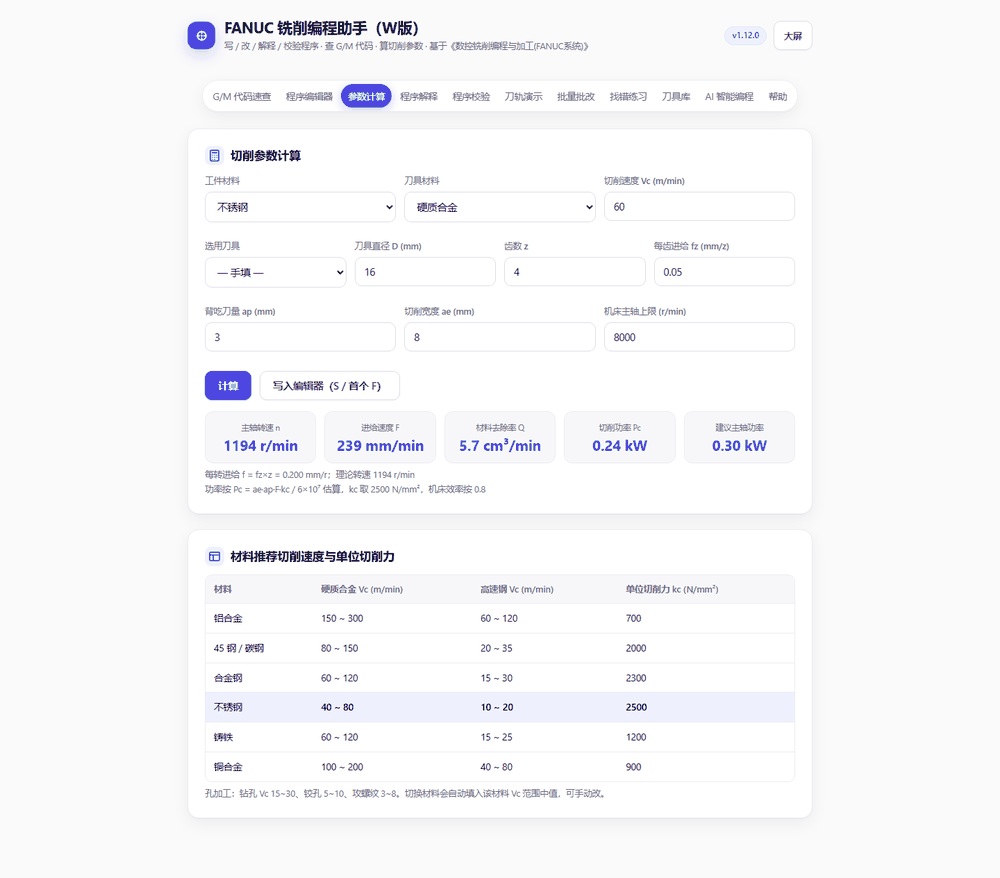

### 4.4 课堂用法建议

1. **演示转速的敏感性**：D 从 10 改到 20，n 立刻减半；再讲"为什么大刀要降转速"。
2. **演示上限折算**：把主轴上限设成 3000，Vc 填 300、D 填 5，看提示"已按上限折算，实际 Vc 会低于设定值"——这就是车间里"想快也快不了"的真实约束。
3. **功率意识**：ap 从 2 改到 6，Pc 翻三倍，讲"小机床吃不动大刀"。

### 4.5 限制

- kc 是**平均值**，实际随材料硬度、刀具前角、磨损变化很大，结果只能做量级判断，不能作为工艺卡数据。
- 没有考虑机床刚性、夹具刚性、刀具悬伸，这三项在真实加工中经常是瓶颈。
- 只有顺铣常规铣削的参数，没有高速切削、摆线铣等特殊策略。

---

## 5. 模块四 · 程序解释

### 5.1 定位

把学生看不懂的程序翻译成人话。这是所有模块里**使用频率最高**的一个——学生写完了、跑不通了、或者拿到别人的程序，第一个动作就是贴进来解释。

### 5.2 输入与操作

**输入**：多行文本框，粘贴任意 FANUC 程序。
**操作**：点「逐行解释」，或从编辑器/骨架上点「解释这段程序」自动带入。

### 5.3 输出结构

顶部一行统计：`共 N 行 · M 个有效程序段 · G 指令 X 种 · M 指令 Y 种`

下面逐行显示，每行两块：

```
G41 D01 X0 Y0 F300          ← 原文（等宽蓝字）
刀具半径左补偿；坐标…       ← 解释（黄字为指令，灰字为地址字）
  ├ G41 刀具半径左补偿
  ├ D01 刀具半径补偿号 D01
  ├ X0  X 轴终点坐标 0
  ├ Y0  Y 轴终点坐标 0
  └ F300 进给速度 F300 mm/min
```

### 5.4 地址字解释会随上下文变化

这是本模块的关键设计——同一个字母在不同指令下含义完全不同：

| 地址字 | 出现场景 | 解释 |
|---|---|---|
| `R` | 同段有 G02/G03 | 圆弧半径（≤180° 取正，>180° 取负） |
| `R` | 同段有 G81~G89 | R 平面高度 |
| `F` | 同段有 G84/G74 | 进给（应 = 螺距 × 转速） |
| `F` | 同段有 G95 | 每转进给 mm/r |
| `F` | 其他 | 进给速度 mm/min |
| `X/Y` | 固定循环段 | 孔位坐标 |
| `Z` | 固定循环段 | 孔底深度 |
| `I/J/K` | 圆弧段 | 圆心相对起点的增量 |
| `I/J/K` | 固定循环段 | 循环参数 |
| `P` | 同段有 M98 | 子程序号 |
| `P` | 同段有 G82/G86/G88/G89 | 孔底暂停时间（毫秒） |
| `D` | 同段有 G41/G42 | 刀具半径补偿号 |
| `H` | 同段有 G43/G44 | 刀具长度补偿号 |
| `T` | 同段有 M06 | 换刀刀具号 |

**增量/绝对**也会跟着变：程序里出现 G91 之后，之后的 X/Y/Z 会解释为"增量坐标"而不是"终点坐标"，直到出现 G90。

### 5.5 宏程序语句

含 `#` 的行或 `IF/GOTO/WHILE/END` 行，走专门的解释分支：

| 语句 | 解释 |
|---|---|
| `#1=10` | #1 赋值为右侧表达式的计算结果，并显示表达式中文 |
| `WHILE [#1 LT 5] DO 1` | 当条件成立时重复执行循环体，直到 END 1；条件显示为 `#1 < 5` |
| `END 1` | 循环体结束，回到配对的 DO 1 |
| `IF [#1 EQ 1] GOTO 10` | 条件成立则跳转到 N10 |
| `IF [...] THEN ...` | 条件成立则执行本段 THEN 之后的部分 |
| `GOTO 10` | 无条件跳转到 N10 |

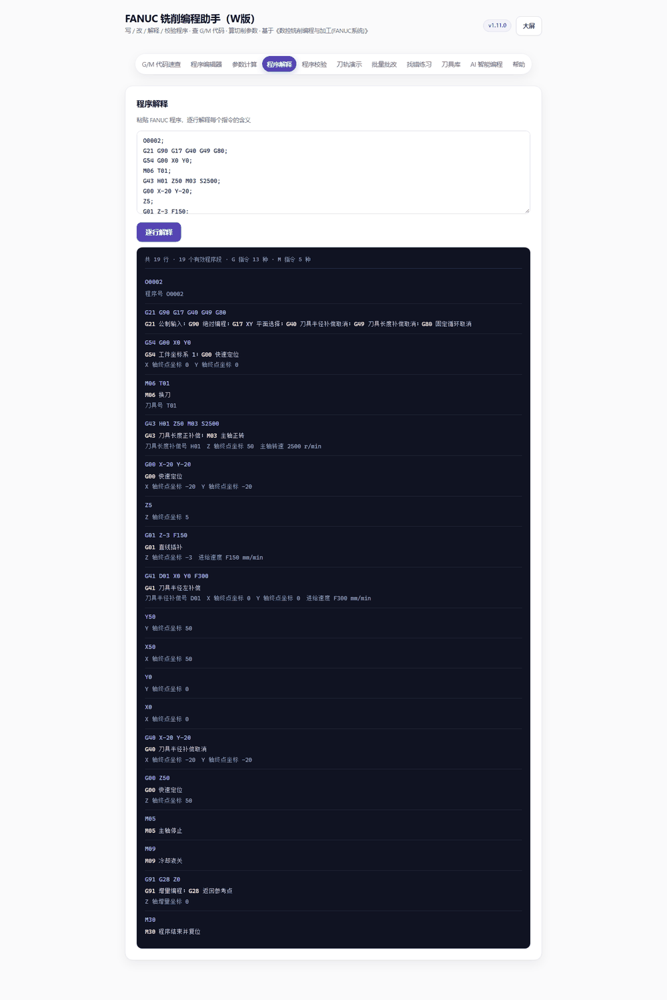

表达式里的函数名会翻成中文：`SIN` → 正弦、`SQRT` → 平方根、`ROUND` → 四舍五入；比较符翻成符号：`EQ` → `等于`、`LT` → `<`。

### 5.6 注释处理

支持三种注释写法：
- `(建立刀补)` —— 括号注释，会作为 `// 建立刀补` 显示在行尾
- `;` 后的内容 —— 当作行尾注释
- 中文分号 `；` 同样识别

### 5.7 课堂用法建议

- **讲一条程序前先跑一遍**，把输出投屏，学生边看边对代码，比口头念快得多。
- **让学生自己对照**：作业发下去时附上解释输出，学生改错时能定位到具体哪一行理解错了。
- **找出"以为是 A 其实是 B"**：比如 `G90 G28 Z0` 里的 Z0 不是"到 Z=0"，而是"经中间点回参考点"，解释里会显示 G28 的完整含义。

### 5.8 限制

- 只解释**字面含义**，不做语义检查。`G01 X100` 是不是超出行程，解释器不管——那是校验器的事。
- 不解析表达式内部（如 `X#1` 这种宏变量当坐标的写法），会原样显示为地址字。
- 固定循环的详细动作（如 G83 每次啄多深、抬多少）只给参数含义，不给动作分解。

---

## 6. 模块五 · 程序校验

### 6.1 定位

本工具的核心。用 43 条规则模拟"老教师看程序"的过程，把常见错误在**上机床之前**抓出来，并且每条都给"为什么错、怎么改"。

### 6.2 输入

| 输入项 | 说明 |
|---|---|
| 攻螺纹螺距 (mm/r) | G84 校验用，默认 1.5（M10 粗牙），换 M8 填 1.25、M12 填 1.75 |
| 主轴转速上限 (r/min) | S 值超限告警，默认 8000 |
| 取编辑器内容 | 一键把编辑器里的程序带进来 |
| 校验框 | 可直接粘贴任意程序 |

### 6.3 输出

顶部汇总：`错误 N · 警告 M · 提示 K ｜ 段数 · G 指令处数 · M 指令处数 · 子程序数 · 变量数`

下面按**行号顺序**列出问题，每条包含：级别、行号、"第几行"、问题描述、规则编号。

**每条错误和警告都可以展开**「为什么 / 怎么改」，例如：

> **E03** 第 14 行 · G41 打开后没有 G40 取消，轮廓结束会带着刀补走，极易过切
> - 为什么会出事：刀补一直在生效，后面的定位、退刀都按补偿后的轨迹走，轮廓接刀处会过切或留台阶。
> - 怎么改：轮廓走完立即 G40 取消，并回到安全位置。

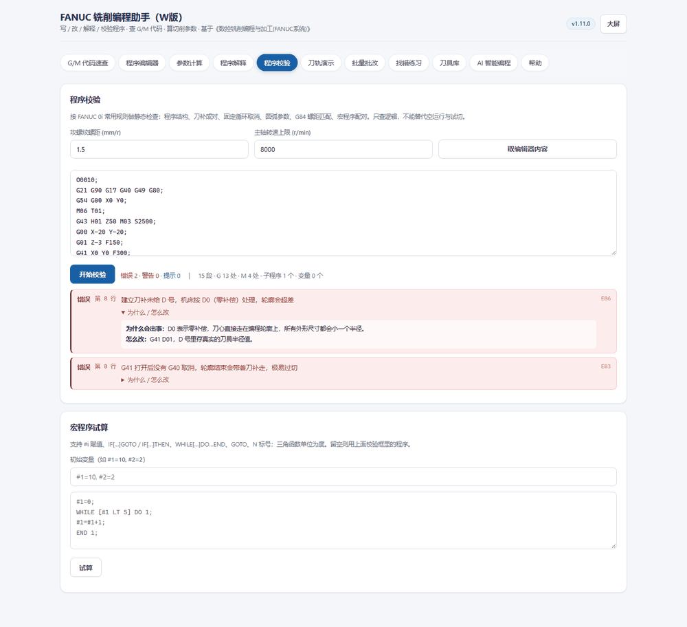

### 6.4 三级严重度

| 级别 | 含义 | 处理建议 |
|---|---|---|
| 错误 | 程序跑不通或有撞刀风险 | 必须改，改完再上机 |
| 警告 | 能跑但可能出问题 | 结合实际情况判断，讲清楚为什么 |
| 提示 | 优化建议或信息 | 可改可不改，用于讲解 |

### 6.5 两个关键设计

**① 片段模式（I06）**
如果内容没有 O 号、也没有 M30，程序会按"指令片段"校验——只查指令用法，不查程序头尾结构。这样讲 G68 旋转、G51.1 镜像这类单条指令时，不会莫名其妙报"缺程序号"。

**② 子程序不误报（W04 抑制）**
主程序在 M30 前用 M05 停了主轴，之后定义的子程序体里还有 G01 切削——按线性扫描会误判"切削时主轴没转"。校验器识别到"进入子程序定义"后不再做这项检查。

### 6.6 宏程序试算器

校验面板下方还有一块「宏程序试算」，用于讲宏程序时验证"变量到底变成多少"。

**输入**：程序（留空则用上面校验框里的）、初始变量（如 `#1=10, #2=2`）。
**输出**：逐步执行轨迹表（步号、行号、语句、执行说明）+ 最终变量值。

**支持的语法**：

| 类别 | 支持内容 |
|---|---|
| 赋值 | `#i = 表达式` |
| 条件跳转 | `IF [条件] GOTO n`、`IF [条件] THEN ...` |
| 循环 | `WHILE [条件] DO m` … `END m`（可嵌套） |
| 无条件跳转 | `GOTO n` + `N` 标号 |
| 运算 | `+ - * / MOD`、括号、`#[#1]` 间接引用 |
| 比较 | `EQ NE GT GE LT LE`（也可写 `== != > >= < <=`） |
| 逻辑 | `AND OR XOR NOT` |
| 函数 | `SIN COS TAN ASIN ACOS ATAN SQRT ABS ROUND FIX FUP LN EXP` |

三角函数**单位为度**（`SIN[30] = 0.5`），与 FANUC 一致。执行超过 2000 步会中止并提示疑似死循环。

### 6.7 课堂用法建议

1. **改一段程序，看错误一条条消失**——这是最有效的教学节奏，比讲十条规则管用。
2. **故意留错让学生找**：把常见错误（缺 D 号、缺 G40）留在程序里，先让学生自己找，再用校验器验证。
3. **讲"为什么错"而非"哪里错"**：展开每条的教学解释，学生记住的是后果，不是符号。

### 6.8 限制

- **静态检查**，不做几何仿真。它不知道工件多大、夹具在哪，所以不会发现"这条路会撞夹具"。
- 不检查尺寸是否正确——那是「刀轨演示 → 尺寸核对」的职责。
- 不检查刀具是否超行程、刀柄是否干涉。
- 规则基于 FANUC 0i 常见用法与教材约定，不同机床厂商的默认参数（如 G98/G99 初始平面）可能略有差异。

---

## 7. 模块六 · 刀轨演示

### 7.1 定位

把程序"画出来"。黑板上画不出的圆弧和刀补，这里有。

### 7.2 输入

| 输入项 | 说明 |
|---|---|
| 刀半径 (mm) | 用于画刀具圆和刀补偏置，默认 5 |
| 快移速度 (mm/min) | 用于估算工时，默认 20000 |
| 取编辑器 / 取校验框 | 一键带入程序 |
| 程序框 | 可直接粘贴 |

**两个开关**：
- 显示刀补偏置：是否画出 G41/G42 生效时的刀心偏移轨迹（橙色点线）
- 显示快移：是否画出 G00 段（灰色虚线）

**「生成刀轨」**：解析并绘制。

### 7.3 支持的指令范围

| 指令/写法 | 处理方式 |
|---|---|
| G00 / G01 | 直线段 |
| G02 / G03 + R | 由 R 求圆心，R 为正取劣弧、为负取优弧 |
| G02 / G03 + I/J | 圆心 = 起点 + (I, J) |
| 整圆（终点 = 起点 + I/J） | 正确识别为 360° 圆弧 |
| G90 / G91 | 绝对 / 增量坐标 |
| G41 / G42 / G40 | 记录补偿状态并绘制偏置层（见 7.6） |
| G73~G89 | 识别孔位，画孔标记；循环内的定位按快移处理 |
| M98 / M99 | **展开子程序**（支持同文件定义的 O 号，`L` 重复次数，嵌套最多 4 层） |
| Z 向移动 | 只记录，不参与 XY 轨迹 |

### 7.4 界面布局

生成后是**两栏**：

- 左栏：只读的代码列表（带行号），当前段对应行黄底高亮
- 右栏：画布

**双向联动**：
- 点代码某一行 → 画布跳到该行产生的段（若该行不产生 XY 轨迹，会提示"换刀、主轴或 Z 向移动"）
- 点画布上的任意轨迹 → 反查最近的一段（命中容差 14 像素），对应代码行高亮

这个联动是讲"这行管那段"最直接的工具。

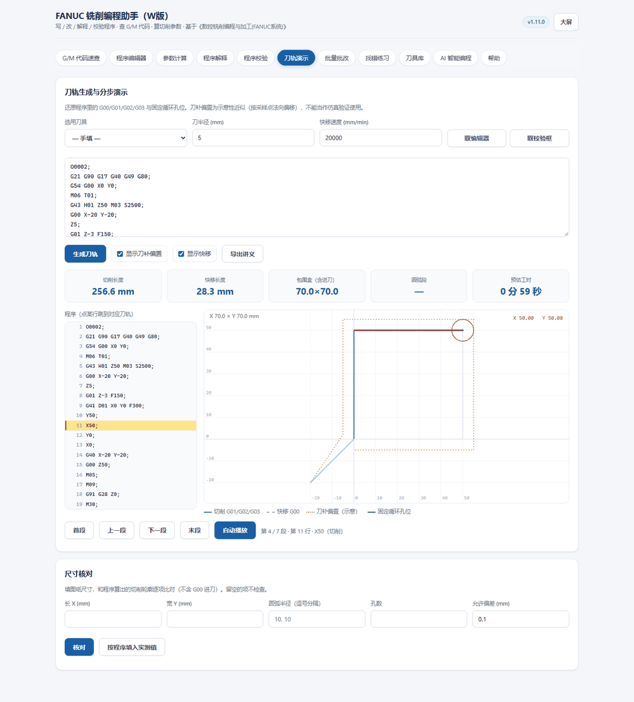

### 7.5 画布元素

| 元素 | 含义 |
|---|---|
| 浅灰网格 + 坐标数字 | 每格间距自适应（在 0.5~1000mm 之间按图形大小选） |
| 蓝色实线 | 切削进给（G01/G02/G03） |
| 灰色虚线 | 快速定位（G00） |
| 橙色点线 | 刀补偏置轨迹（示意） |
| 绿色小圆 + 十字 | 固定循环孔位 |
| 红色圆 | 当前刀具位置，半径 = 刀半径 |
| 红色粗线 | 当前执行的段（分步时） |
| 浅灰细线 | 尚未执行的段（分步时） |
| 左上角文字 | 包围盒尺寸 `X × Y mm` |
| 右上角文字 | 当前刀心坐标 `X … Y …` |

### 7.6 刀补偏置的画法（重要说明）

**这是"示意"，不是仿真。** 具体口径：

1. 按段计算各自偏移：直线整段用同一法向平移，圆弧按采样点逐点法向偏移。
2. 拐点用**角平分线（miter）**求真实偏移交点，所以方形的偏置仍是方形，四个角不会变斜。
3. **建立刀补的那一段，起点保持编程点**，只有终点偏移——这与 FANUC 的刀补建立过程一致：刀心从编程点斜向切入偏置位置。
4. **G40 取消那一段不画偏置**——真机在这一段是从补偿位置回到编程点。所以橙色线终点会和蓝色轮廓角点差一个刀半径，这是正常现象。

### 7.7 分步演示

| 按钮 | 作用 |
|---|---|
| 首段 / 上一段 / 下一段 / 末段 | 单段跳转 |
| 自动播放 | 每 450ms 前进一段，再点变「暂停」 |

当前段信息显示在按钮右侧：`第 4 / 7 段 · 第 11 行 · X50（切削）`。

### 7.8 指标卡

| 指标 | 含义 |
|---|---|
| 切削长度 | 所有 G01/G02/G03 段长度之和 |
| 快移长度 | 所有 G00 段长度之和 |
| 包围盒（含进刀） | 全部轨迹的 X/Y 跨度，**含 G00 进刀** |
| 圆弧段 | 圆弧段数量 |
| 预估工时 | 切削长度 ÷ 各段 F + 快移长度 ÷ 快移速度 + 换刀 8s/次 + G04 暂停时间 |

**注意**：这里"包围盒"含进刀段，和下方「尺寸核对」用的轮廓闭环值（不含进刀）不是同一个口径，所以标签特意写了"含进刀"。

### 7.9 尺寸核对（同面板下方）

**用途**：核对程序加工出来的尺寸，是否符合图纸。

**输入**：长 X、宽 Y、圆弧半径（可填多个，逗号分隔）、孔数、允许偏差（默认 0.1mm）。留空的项不检查。

**范围口径**：
1. 先做**轮廓闭环识别**——沿切削段行走，走回已经过的顶点就判定为封闭轮廓，取面积最大的那个环。
2. 识别到闭环 → 用它算长宽（自动排除 G01 进刀）。
3. 没识别到闭环 → 回退到"全部切削移动"的范围。

结果表下方会标明本次用的是哪个范围，例如：`范围：轮廓闭环（已排除进刀）`。

**输出表**：项目 / 图纸 / 程序实测 / 偏差 / 判定（合格或超差+偏差值）。

**「按程序填入实测值」**：把实测值直接填进输入框，方便出标准答案（先填实测，再改成图纸值看差多少）。

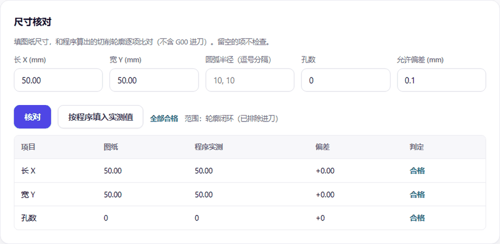

### 7.10 课堂用法建议

1. **讲刀补**：先关掉「显示刀补偏置」，让学生看程序轨迹；再打开，对比刀心实际走的路线。讲"为什么轮廓要留余量"时特别直观。
2. **讲圆弧正负 R**：同一个 R10 改成 R-10，画布上的弧立刻从劣弧翻成优弧。
3. **讲子程序**：用「子程序结构」模板生成刀轨，学生能看到 M98 调用的内容被展开画出来了。
4. **讲工时**：改 F 值，看预估工时变化，让学生建立"进给影响效率"的量感。
5. **讲尺寸**：把图纸尺寸填进「尺寸核对」，故意把程序里某个 Y 值改错 2mm，看判定变超差。

### 7.11 限制

- **二维**：只画 XY 平面投影，不显示 Z 高度、不判断是否真的切到材料。
- **不做材料去除**：看不到过切和欠切的实体效果。
- **不模拟机床**：不考虑行程限制、夹具、刀柄干涉。
- **G68 坐标旋转**未作用于轨迹（只解释文字），旋转类程序画出来仍是未旋转的。
- 刀补偏置是**示意性近似**，圆角处与真机可能有零点几毫米差异，不能当作验证依据。
- 固定循环只画孔位，不画钻头上下动作。

---

## 8. 模块七 · 批量批改

### 8.1 定位

课后作业一次几十份，逐份看太慢。这个模块把"打分"和"看出来错在哪"自动化，教师只需要复核异常项。

### 8.2 输入

**两种交作业的方式**：

1. **粘贴**：多份程序之间用一行 `====`（三个及以上等号，或 `----`、`****`）隔开。
2. **选文件**：点选择文件，可多选 `.nc / .txt / .tap / .prg / .cnc`，系统按文件名顺序拼接并用 `====` 自动分隔。

**标准答案（可选）**：填了就做刀轨对比，不填就只做规则校验和统计。

**评分权重**：

| 输入 | 默认 | 含义 |
|---|---|---|
| 每个错误扣分 | 10 | 有 3 个错误就扣 30 |
| 每个警告扣分 | 3 | 有 2 个警告扣 6 |

得分公式：`max(0, 100 − 错误数 × 错误扣分 − 警告数 × 警告扣分)`。

### 8.3 输出

**汇总行**：`共 N 份 · 平均分 XX · 合计错误 N 处`

**成绩表**（每份一行）：

| 列 | 含义 |
|---|---|
| # | 序号 |
| 程序号 | 从程序首行 O 号取，取不到显示"第 N 份" |
| 错误 / 警告 | 规则检出数量 |
| 得分 | 按权重算 |
| 段数 | 有效程序段数 |
| 切削长 (mm) | 切削轨迹总长 |
| 工时 | 同刀轨模块的估算口径 |
| 最大偏差 (mm) | 与标准答案刀轨的最大距离，未填标准答案则显示 — |

**点任意一行** → 下方展开该份的：
1. 完整问题清单（带"为什么/怎么改"）
2. 下方「刀轨对比」卡片里，标准答案（绿）与学生程序（蓝）的刀轨叠加，并给出最大偏差与平均偏差

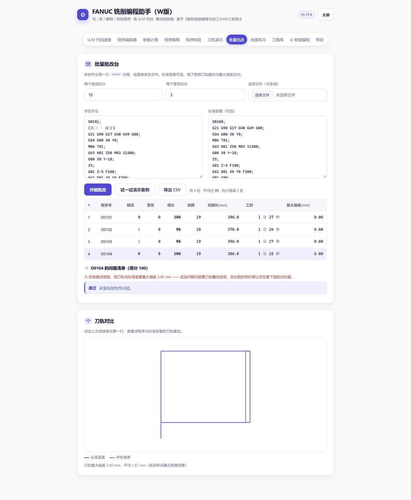

### 8.4 导出 CSV

点「导出 CSV」下载 `批改结果.csv`，含 BOM，Excel 双击打开不乱码。列与成绩表一致，可直接贴到成绩册。

### 8.5 课堂用法建议

1. **当堂收作业**：让学生把程序发到群里，教师一次性粘进批量框，30 秒出全班成绩。
2. **重点看偏差列**：规则全过但偏差很大的，往往是"程序语法没问题但轮廓画错了"，这类最需要面批。
3. **对比讲评**：点开偏差最大的那份，把它的轨迹和标准答案叠在一起投屏，学生一眼看出错在哪条边。

### 8.6 限制

- **必须用 `====` 分隔**。如果直接把多份程序首尾相连粘进去，会被当成一份处理（因为子程序也用 O 号开头，无法可靠自动切分）。
- 偏差是"采样点到对方轨迹的最近距离"的近似值，用于发现明显偏离，不是精确的轮廓度评定。
- 一次建议不超过 50 份，太多会卡（纯浏览器计算）。

---

## 9. 模块八 · 找错练习

### 9.1 定位

给学生一个"有病"的程序，让他当医生。比"从零写程序"门槛低，比"看例题"参与度高。

### 9.2 输入

| 输入项 | 说明 |
|---|---|
| 基础程序 | 4 个内置骨架之一，或「取编辑器内容」用自己的程序 |
| 注入错误个数 | 1~6，默认 3 |

点「生成病灶程序」，系统在基础程序里**随机注入**若干典型错误。

### 9.3 十种可注入的错误

| 规则 | 注入内容 | 学生应发现的问题 |
|---|---|---|
| E06 | 删掉 G41/G42 后面的 D 号 | 刀补没有补偿量，按 D0 走 |
| E05 | 删掉 G43 后面的 H 号 | 长度补偿无效，Z 会扎下去 |
| E03 | 删掉 G40 | 刀补一直生效，接刀处过切 |
| E12 | 删掉 G80 | 后面的定位被当成继续钻孔 |
| E02 | 删掉 M30 | 程序结束不复位 |
| E09 | 把 G84 的 F 改成一半 | 进给与螺距×转速不符，螺纹乱扣 |
| E10 | 删掉圆弧的 R | 圆心无法确定 |
| W04 | M03 改成 M05 | 切削时主轴不转 |
| E04 | 在 G02/G03 段加 G41 | 圆弧段建立刀补，FANUC 会报警 |
| E07 | 同段写 G90 和 G91 | 模态组冲突，后写覆盖前写 |

### 9.4 流程

1. 选基础程序 + 错误个数 → 生成
2. 学生对着代码找错（可以先用肉眼找，也可以送去「程序校验」让机器找）
3. 点「交卷看答案」

### 9.5 答案页内容

**注入清单表**：位置（第几行）/ 说明 / 对应规则 / 校验器是否检出

**完整校验结果**：和「程序校验」面板一样的输出，带教学解释

顶部汇总：`注入 N 处，校验器检出 M 处`

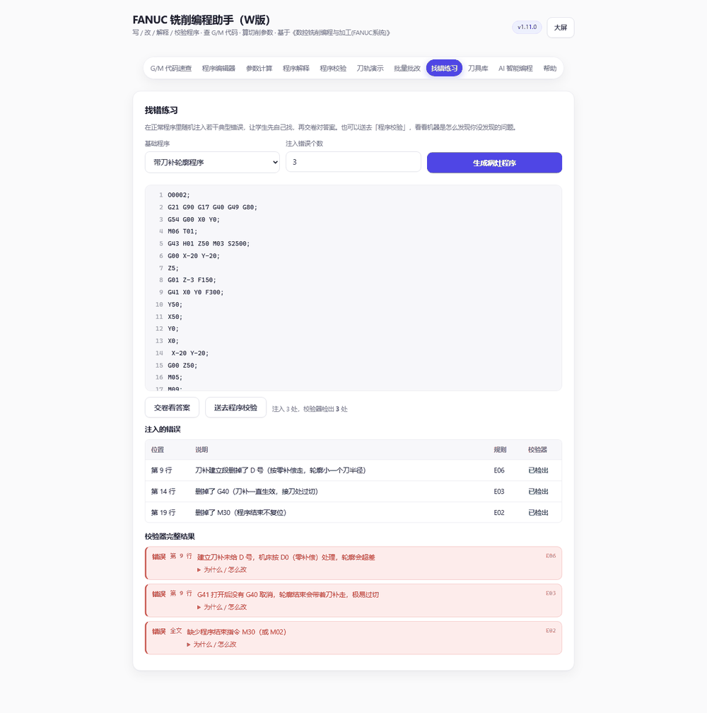

### 9.6 设计说明

**注入的错误一定能被校验器检出**——这是刻意保证的，测试里逐条验证了 10 种变异各自都能被抓到。所以学生自己查出来的结果，和答案能对上，不会出现"我明明改了但工具没报"。

**为什么可能少于设定个数**：同一行只能注入一处错误。如果基础程序里可注入的位置不够（比如只有 4 个可改的地方），选 6 也只会有 4 处。界面会按实际数量提示。

### 9.7 课堂用法建议

1. **限时比赛**：3 分钟找 5 处错误，找到最多的小组加分。
2. **找完再验证**：学生找完点「送去程序校验」，看机器报出来的和自己找的是不是一样，差在哪。
3. **反向练习**：让学生自己用「找错练习」的十种手法去改同学的程序，互相出题——改的人要理解为什么这是错，比只做题更深一层。

### 9.8 限制

- 只能注入这 10 类错误，覆盖面有限（宏程序错误、尺寸错误不在其中）。
- 不能"只注入到指定行"，随机选择目标行。
- 病灶程序是内存态的，刷新后仍在（本地保存），但不产生文件。

---

## 10. 模块九 · AI 智能编程

### 10.1 定位

两条路，别混着用：

| 方式 | 谁在算 | 适合 |
|---|---|---|
| **图纸生成**（推荐） | 几何由本地确定性解析/识别，程序由本地生成器按固定规则输出 | 有图纸、要尺寸说得清、要能验收 |
| 文字生成 | 云端模型直接写程序 | 没图纸、只想快速看一版思路 |

图纸生成的好处是：轮廓、刀补、层数、转速进给都由参数算出来，同样的输入永远得到同样的程序，出了问题能定位到具体环节。

### 10.2 图纸生成

#### 10.2.1 支持的图纸格式

| 格式 | 处理方式 | 准确性 | 备注 |
|---|---|---|---|
| **SVG**（矢量） | 浏览器内本地解析 | **几何精确** | 支持 `rect` / `circle` / `ellipse` / `polygon` / `polyline` / `path`（M L H V C S Q T A Z），支持 `<g transform>`；圆弧按弦高 0.05 mm 离散成直线段 |
| **PNG / JPG / WebP**（位图） | 云端视觉模型识别成轮廓 JSON | 需人工核对 | 需要登录发布链接、联网，且要求有支持读图的模型 |

- 位图会先缩到最长边 1200 px 再送模型，文件上限 8 MB。
- SVG 的单位按 `width`/`height` 的物理单位换算（mm/cm/in/pt/px）。只写了 `width="96"` 这类无单位值时按 96 dpi 折算，界面会提示"尺寸可能不准"。

#### 10.2.2 适用的零件类型

| | 范围 |
|---|---|
| **适用** | 二维轮廓件、板类零件、多孔板；单个零件、正投影视图、带闭合外轮廓；轮廓由直线/圆弧/圆组成 |
| **不适用** | 三维曲面与型腔曲面、装配图与剖视图、齿轮与螺纹、薄壁（< 0.5 mm）、只有实物照片没有图纸、需要多工序多刀具的复杂工艺 |

越界的情况不会硬生成：要么在识别阶段就报错，要么在生成前被检查拦住（见 10.2.6）。

#### 10.2.3 生成所依据的参数

| 参数 | 默认 | 影响 |
|---|---|---|
| 工件材料 | 45 钢 | 决定切削速度 Vc 中值 → 主轴转速 n = 1000·Vc/(π·D) |
| 刀具号 T | 01 | 同时作为长度补偿 H 号与刀补 D 号（`G43 H01` / `G41 D01`） |
| 刀具直径 D | 10 mm | 决定切入引出距离（R + 2 mm）、内轮廓能否进刀、孔是钻还是铣 |
| 刃数 z | 2 | 与每齿进给一起算 F |
| 每齿进给 fz | 0.06 mm/z（内置） | 进给 F = n·fz·z |
| 每层切深 ap | 1 mm | 层数 = ⌈总深 / ap⌉，各层均分（不是最后一层留余量） |
| 加工总深 | 3 mm | 轮廓每层下切到 Z-1、Z-2、Z-3 |
| 安全高度 | 10 mm | 快移与换层时的抬刀高度 |
| 孔加工方式 | 自动 | 孔径与刀具直径相差 ≤ max(0.3, 8%D) 用 `G81` 钻孔，否则用当前刀具铣整圆 `G02 I- J0` |
| 毛坯长 / 宽 | 可空 | 只用于超程检查（D05） |

坐标系与基准：

- 工件坐标系 `G54`，原点取**零件外轮廓左下角**（图纸解析后已归一化到这个点）。
- Z0 在零件上表面，切深向下为负。
- 轮廓一律用 **G41 + D 号** 编程（按图纸轮廓编程，半径由刀补让出），外轮廓按**顺时针**、内轮廓按**逆时针**走刀，保证顺铣。
- 程序注释全部用英文（`(CONTOUR 1 OUTER PASS 1/3 Z-1)`），避免部分 FANUC 系统读中文括号报警。

#### 10.2.4 生成的程序结构

```gcode
O1001 (DRAWING 2D CONTOUR)
(MAT S45C  TOOL D10  DEPTH 3)
G21 G90 G17 G40 G49 G80
G54 G00 X0 Y0
M06 T01
G43 H01 Z10 M03 S3661
M08
(TOOL RADIUS 5 -> SET IN D01)
(CONTOUR 1 OUTER PASS 1/3 Z-1)
G00 Z10 / G00 X.. Y..（最高点上方切入位置）
G01 Z-1 F175
G41 D01 X.. Y.. F439        ← 建立刀补切入
G01 ...（沿轮廓）
G01 X.. Y..（回到起点）
G40 X.. Y..                 ← 取消刀补退刀
(CONTOUR 2 INNER PASS 1/3 Z-1)
...
(HOLES 1 x 10 DRILL)        ← 直径匹配的孔
G98 G81 Z-3.5 R2 F219
X30 Y20
G80
(HOLES 4 MILLED BY D10)     ← 直径不匹配的孔，铣整圆
G00 Z10 / G00 X.. Y.. / G01 Z-1 F175
G02 X.. Y.. I-3 J0 F439
M09 / M05 / G91 G28 Z0 / G90 / M30
```

#### 10.2.5 生成后的预览与校验

生成即自动跑三样，不需要另外点：

1. **指标行**：轮廓数、孔数、层数（含 ap）、S、F、切削长度、预估工时
2. **校验结果**：图纸层面的问题（D 系列）＋ 程序校验器的 43 条规则合并显示，每条带"为什么 / 怎么改"
3. **刀轨图**：蓝色切削、灰色虚线快移、红点是钻孔位置；下面是完整程序文本

三个按钮：**载入编辑器**（继续手改）、**复制程序**、**下载 .nc**。

#### 10.2.6 无法识别或不满足加工条件时的提示

| 代码 | 级别 | 含义与处理 |
|---|---|---|
| D00 | 错误 | 还没有解析出图形——先上传图纸 |
| D01 | 错误 | 没有闭合轮廓，无法做轮廓铣削 |
| D02 | 错误 | 某条轮廓点数不足 3，无法成环（图纸可能是散的线） |
| D03 | 错误 | 内轮廓最小宽度小于刀具直径，刀进不去——换小刀 |
| D04 | 警告 | 存在尖角，刀具半径大时加工不到尖处，实际会有残留圆角 |
| D05 | 错误 | 零件尺寸超出毛坯 |
| D06 | 警告 | 图纸本身的可疑点（无单位、按像素折算等） |
| D07 | 警告 | 只有孔没有轮廓，只生成孔加工程序 |

位图方式的额外提示：

| 提示 | 含义 |
|---|---|
| 当前没有可用的视觉模型（不支持读图） | 云端没给可用读图模型，改用 SVG |
| 无法识别：… | 模型判定图不是二维铣削零件（三维视图/装配图/照片等） |
| 模型返回的不是有效 JSON | 识别输出不合法，重试或改 SVG |
| 轮廓由视觉模型识别，**必须**核对尺寸 | 位图结果只作参考，必须与图纸标注逐项比对 |
| 模型自评可信度较低 | confidence < 0.7，建议改 SVG 或手工修正 |

### 10.3 文字生成

| 输入项 | 说明 |
|---|---|
| 加工类型 | 平面铣削 / 外轮廓 / 内轮廓 / 孔加工 / 槽加工 |
| 工件材料 | 铝合金 / 45 钢 / 合金钢 / 不锈钢 / 铸铁 |
| 刀具直径 (mm) | 默认 10 |
| 补充要求 | 自由文本，如"零件尺寸 50×50，铣深 2mm，用子程序" |

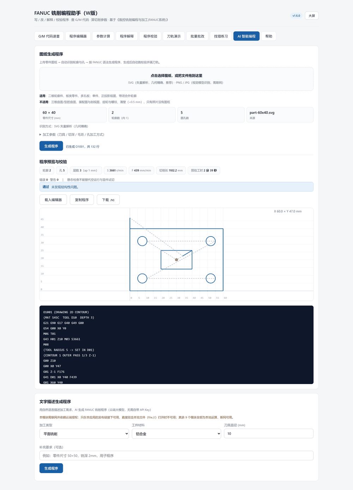

点「生成程序」→ 结果区**流式输出**（边生成边显示）→ 完成后可「载入编辑器」继续手改，或「解释这段程序」送去逐行翻译。生成过程中可点「停止生成」中止。

### 10.4 技术说明

- 走 WorkBuddy Cloud 的云端大模型，**页面不保存任何 API Key**，学生机不需要配置密钥。
- 模型由云端动态下发，页面不写死模型 ID；位图识别优先挑 `supportsImages` 的模型。
- 文字方式的 System Prompt 内置安全约束：必须含初始化与 M30、刀补成对、换刀后 G43、对刀后先空运行。
- **图纸方式的程序不是模型写的**：模型只负责把图认成轮廓 JSON，程序由本地生成器按 10.2.3 的规则拼装，因此语法与几何都可复现。

**出错提示对照**：

| 提示 | 含义 |
|---|---|
| 云服务额度不足或限流 | 云端配额问题，稍后重试 |
| 云服务鉴权失败（Origin 不匹配） | 当前访问地址不在允许列表，通常是直接用 file:// 打开导致 |
| 模型服务暂时不可用 | 云端服务波动，重试 |

### 10.5 课堂用法建议

**定位成"反面教材生成器"比"标准答案生成器"更有价值**：

1. 文字方式生成一段轮廓程序，然后**用校验器查它**——AI 也经常漏 D 号、忘 G40、G84 的 F 写成经验值。让学生发现"AI 也会错"，比讲十遍"要检查"管用。
2. 图纸方式更适合讲**工艺参数怎么定**：同一张图改 ap、改刀具直径、改材料，看层数、S/F、工时怎么变；把刀改大到小于内轮廓宽度，看它怎么被 D03 拦下来。
3. **不要**把任何生成结果直接当作业标准答案发下去——都没经过真实试切验证。

### 10.6 限制

- 需要联网，且依赖云端服务可用性与配额。机房断网时该模块不可用（其他 9 个模块全部离线可用）。
- 图纸生成只做**二维轮廓 + 圆孔**：不做型腔清角、不做曲面、不做螺纹、不做多刀具多工序。
- 位图识别的尺寸**不可信到可以直接上机**，必须以图纸标注为准逐项核对。
- SVG 里被忽略的图元：`text`（尺寸数字）、`line`（标注线）、`image`、`pattern` 填充；嵌套 `<use>` 不支持。
- 内轮廓每层都是垂直下刀，实做建议预钻孔或改用螺旋下刀。
- 生成结果**未经真实试切验证**，必须过一遍校验和刀轨演示，首件空运行。
- 用 `file://` 直接双击打开时，云端相关能力会鉴权失败（Origin 为 null）。图纸方式里的 **SVG 解析是纯本地的**，`file://` 下仍可用；位图识别与文字生成需要发布链接。
- 云端密钥与当前发布域名绑定（`https://fanuc-milling-w.app.workbuddy.host`）。通过**本应用官方分享链接**访问时正常；换到别的域名会提示鉴权失败，属预期情况。其余 9 个模块为纯本地运算，断网也能用。

---

## 附录 A · 校验规则全表（43 条）

### A.1 错误（21 条）——必须改

| 编号 | 检查内容 |
|---|---|
| E00 | 没有可校验的程序段（输入为空或全是注释） |
| E01 | 程序第 1 行不是程序号（应为 O + 4 位数字） |
| E02 | 缺少程序结束指令 M30（或 M02） |
| E03 | G41/G42 打开后没有 G40 取消 |
| E04 | 刀补建立/撤销发生在圆弧段（G41/G42 与 G02/G03 同段） |
| E05 | G43/G44 未给 H 号 |
| E06 | G41/G42 未给 D 号 |
| E07 | 同一程序段内有两条同组模态指令（如 G90 与 G91、G00 与 G01） |
| E08 | G84 攻螺纹没有可用的进给 F |
| E09 | G84 的 F ≠ 螺距 × 转速（容差 2%） |
| E10 | 圆弧插补既无 R 也无 I/J/K |
| E11 | M98 未给子程序号 P |
| E12 | 固定循环打开后没有 G80 取消 |
| E13 | WHILE … DO 没有配对的 END |
| E14 | END 没有对应的 DO |
| E15 | END 与 DO 的编号不配对 |
| E16 | 宏表达式语法错误（括号、函数名、运算符） |
| E17 | 首次切削前没有指定进给 F |
| E18 | 程序结束前 Z 仍在负值区（未抬刀） |
| E19 | 跳转目标 N 不存在 |
| E21 | R0 构不成圆弧 |

### A.2 警告（16 条）——需判断

| 编号 | 检查内容 |
|---|---|
| W01 | 未见 G21（若机床在英制状态，尺寸会差 25.4 倍） |
| W02 | 未见 G90（若沿用增量状态，坐标会整体错位） |
| W03 | 未见 G54~G59 工件坐标系 |
| W04 | 出现切削指令时主轴未启动 |
| W05 | 主轴转速超过设定上限 |
| W06 | G04 未给 X（秒）或 P（毫秒） |
| W07 | 固定循环未给 R 平面 |
| W08 | 固定循环首段未给 Z 孔深 |
| W09 | G84 使用 G99 返回 R 平面（有干涉风险） |
| W11 | M98 调用的子程序在本文件中未找到 |
| W12 | IF 条件后缺少 GOTO 或 THEN |
| W13 | 固定循环没有可用的 F |
| W14 | 程序号 O 重复定义 |
| W15 | M30 之后仍有程序段（机床不会执行） |
| W16 | 宏变量在赋值前被使用（按 0 处理） |
| W17 | 整个程序未见 M03/M04 |

### A.3 提示（6 条）——参考

| 编号 | 检查内容 |
|---|---|
| I01 | 指令未收录在本地字典，请自行确认（不代表错误） |
| I02 | R 取负表示优弧（>180°），请确认几何意图 |
| I03 | G84 进给校验通过（显示 F = 螺距 × 转速） |
| I04 | 未见 G17，建议程序头显式写平面选择 |
| I05 | 建议程序头把 G40 G49 G80 一并初始化 |
| I06 | 按"程序片段"校验（只查指令用法，不查头尾结构） |

> 注：E、W 两类共 37 条都带「为什么 / 怎么改」教学解释，点击问题条目下方可展开。

---

## 附录 B · 计算口径与算法说明

### B.1 切削参数

```
n  = 1000 × Vc / (π × D)          [r/min]
F  = n × fz × z                    [mm/min]
f  = fz × z                        [mm/r]（每转进给）
Q  = ae × ap × F                   [mm³/min]
Pc = Q × kc / 6×10⁷                [kW]
Pm = Pc / 0.8                      [kW]（建议主轴功率）
```

若 `n` 超过设定上限，则按上限重算 `n` 与 `F`，并提示实际 Vc 会低于设定值。

### B.2 刀轨工时

```
工时 = Σ(切削段长 / 该段F) + Σ(快移段长 / 快移速度) + 换刀次数×8s + Σ(G04暂停时间)
```

- 某段没有可用 F 时，该段不计入切削时间
- `G04 X2.0` 计 2 秒，`G04 P2000` 计 2 秒（毫秒换算）
- 换刀按每次 8 秒估算

### B.3 刀补偏置

1. 直线段：整段按同一法向平移 `r`（G41 取行进方向左侧，G42 取右侧）
2. 圆弧段：按采样点逐点偏移，法向取局部切线的垂线
3. 拐点：偏移量 = `r × (n₁+n₂) / (1 + n₁·n₂)`，即角平分线方向，保证相邻两段的偏移线相交于一点
4. 刀补建立段（第一个 G41/G42 段）起点保持编程点，只有终点偏移
5. G40 段不做偏置

### B.4 轮廓闭环识别（尺寸核对用）

沿切削段依次行走，记录每个到达的顶点；若新到的顶点与之前某个顶点重合（按 1μm 取整比较），则这两点之间的段构成一个闭环。取所有闭环中**包围盒面积最大**的一个，用它计算长宽。

这样能自动排除 G01 进刀段——进刀点通常不在轮廓上。

### B.5 刀轨偏差（批量批改用）

1. 把学生程序和标准答案的切削段各自采样成点集（每条最多 400 点）
2. 对学生的每个采样点，求它到标准答案所有采样点的最近距离
3. 最大偏差 = 这些距离的最大值；平均偏差 = 平均值

这是**近似**指标，用于发现明显偏离，不是严格意义的轮廓度误差。

### B.6 评分

```
得分 = max(0, 100 − 错误数 × 错误扣分 − 警告数 × 警告扣分)
```

提示（I 类）不扣分。

### B.7 宏表达式求值优先级

从低到高：

```
OR  →  AND / XOR  →  NOT  →  比较(EQ NE GT GE LT LE)  →  加减  →  乘除取余  →  一元正负  →  括号/函数/变量
```

三角函数单位为度。除数为 0、`SQRT` 参数为负、`LN` 参数≤0 均报错。

---

## 附录 C · 已知限制

### C.1 全局

- **纯前端**：所有计算在浏览器本地完成，不上传程序，不保存到服务器（AI 生成模块除外）。
- 数据存在浏览器 localStorage，换机器、清缓存即丢失。
- 单页应用，没有打印专用版式（除导出的讲义 HTML）。

### C.2 刀轨与几何

- 只有 XY 二维，没有 Z 高度与材料去除
- G68 坐标旋转、G51.1 镜像未作用于轨迹
- 刀补偏置是示意性近似
- 不检测行程、夹具、刀柄干涉
- 固定循环只画孔位

### C.3 校验

- 静态检查，不做几何仿真
- 不判断程序"能不能加工出图纸要求的尺寸"（用尺寸核对）
- 规则基于 FANUC 0i 与教材约定，厂商差异需教师自行判断

### C.4 教学内容

- 内置 6 个模板是格式示例，切削参数需按实际重算
- 找错练习仅 10 类错误
- 没有题库与自动判分（尚未实现）

---

*文档随代码同步维护。若代码与本说明不一致，以 `index.html` 的实际行为为准，并请反馈修正。*
